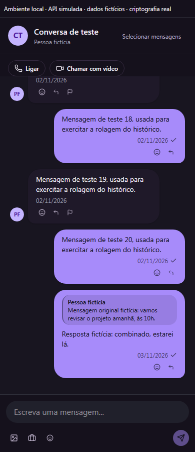
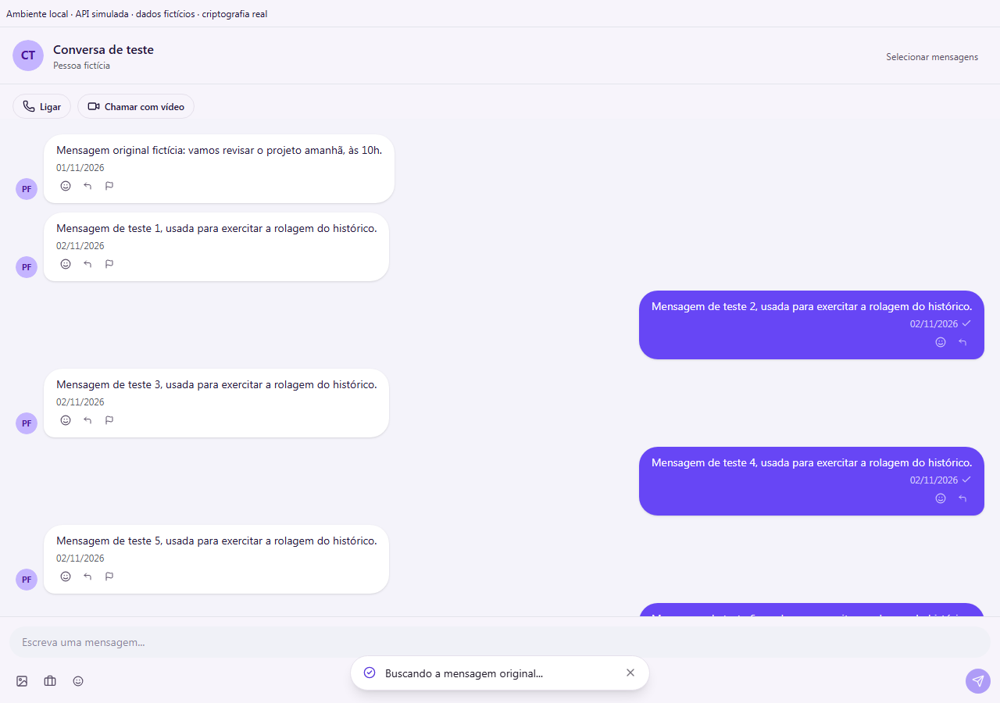

# Prova visual histórica de citações privadas

Esta pasta registra a composição anterior à atualização da PR #896. Os limites e pendências
abaixo descrevem aquela etapa. A composição atual, seus gates e suas capturas estão em
[atualização da QA](atualizacao/README.md).

## Composição

- Frontend: código do commit `d2d605e7527bbbf7b46a405c5bac750b71080f1a`, sobre QA `578c0c89`.
- Design system: código do commit `5a755712254c35d5dc97e8497ebc9ff47bef9cc7`, sobre QA `93362943`.
- Pacote local do DS: SHA-256 `6689e580d372e97c950297b1073e5e39f0f43fce4e7db9d287c7dd062a5a7d34`.
- Capturas obtidas em 15 de novembro de 2026, com dados inteiramente fictícios.

O container real `ConversationThread`, as views do DS e os estilos reais do consumidor foram
executados em um ambiente local de prova. As respostas HTTP foram simuladas; geração de chaves,
IndexedDB e operações RSA/AES usaram a implementação real. Esta prova não representa produção
nem um E2E com backend real.

## Verificação

Em 390 e 1280 px, nos modos claro e escuro:

1. A original começou fora da página carregada.
2. A citação mostrou o trecho decifrado antes de carregar a página da original.
3. O clique buscou uma página antiga, focou a original e rolou somente o quadro da conversa.
4. A ativação por Enter também levou à original.
5. O teste verificou o destino após a rolagem estabilizar; não houve overflow horizontal nem
   erros de página. O resultado estruturado está em `resultado.json`.

## Capturas

Citação decifrada em mobile, modo escuro:

Original alcançada após a navegação paginada em desktop, modo claro:

## Limites da entrega

O pacote local usado nesta prova não foi publicado. A PR permanece em rascunho até uma versão
aprovada do DS ser publicada, a dependência e o lockfile serem atualizados e os gates serem
repetidos após instalação limpa. A suíte global do backend não faz parte desta prova.
