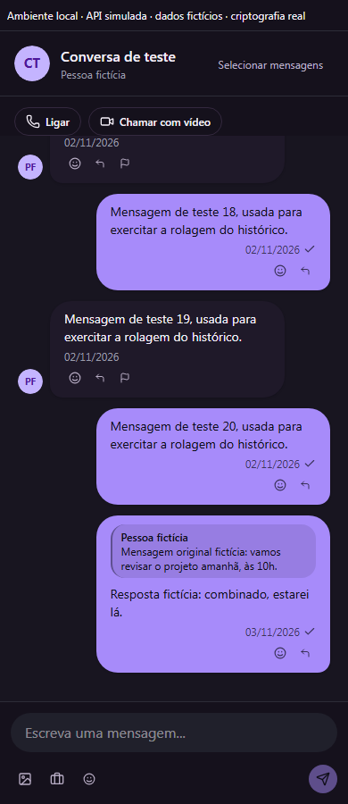
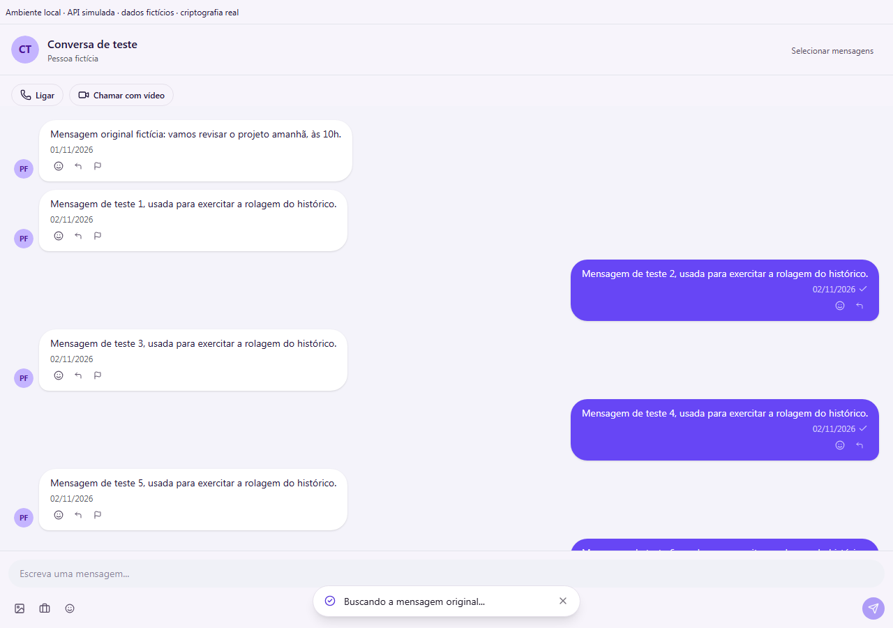

# Prova após atualização da PR #896

## Composição exercitada

- QA do frontend: `4d651c15627a8c6a25e0886b45173733f90be6e3`.
- Histórico publicado preservado: `6c16dc388494836a7ec7f25d099d91de9be8709f`.
- Node: `22.22.2`.
- DS resolvido pelo lockfile da QA: `0.37.10`, construído da fonte oficial
  `465162b8a7e8806d5c70f47e4053edca273d6162`, que contém a PR #249.
- Integridade do tarball reproduzido, idêntica à referência do lockfile:
  `sha512-ay6zPpLPrJXnQ3g1mQAPwprEX58KwNsWydX3hvsZG4wJhLTuMszjfIz9OnJ000f0VPfb9B7+3PKNKKFKG1ZrSw==`.

A atualização incorpora a QA por merge local, sem reescrever commits publicados.
Foram preservados o envio via `refreshConversation`, a restauração da resposta no compositor,
o histórico de chaves, o limite do cache e o tratamento isolado de falha de decifragem.

## Verificações executadas

- Lint, typecheck, build e testes das regras do ESLint aprovados.
- Comparador de supressões aprovado, com baseline idêntica à QA pinada.
- Suíte completa: **1.597 testes aprovados**, sem falhas, pendências ou TODOs.
- Nenhuma regressão da correção de citações foi retirada; as diferenças de identidade em relação
  ao relatório histórico são de cinco arquivos mantidos idênticos à QA atual.
- Quatro combinações de navegador: 390 e 1280 px, claro e escuro. A citação foi decifrada antes
  de carregar a original, o clique buscou uma página antiga, focou a original dentro do quadro e
  Enter repetiu a navegação. Sem overflow horizontal, erros de página ou endpoints não previstos.

## Capturas atuais

Dados inteiramente fictícios, API simulada, IndexedDB e RSA/AES reais. O container e as views do
aplicativo/DS são reais. Isso não é um E2E integrado com o backend.

O resultado das quatro combinações está em `resultado.json`. As capturas da pasta superior
pertencem à composição histórica anterior à atualização, não a esta prova.

## Limitação do registro

O download local pelo GitHub Packages retornou `401`. Para validar sem alterar credenciais,
o DS foi construído da fonte oficial e seu tarball reproduziu exatamente a integridade SHA-512
registrada no lockfile. Todos os 2.883 arquivos do pacote instalado foram comparados ao tarball;
490 pacotes instalados foram conferidos contra as versões do lock, sem divergência ou dependência
não opcional ausente.

As dependências públicas vieram de instalação pelo lock em scratch; apenas a origem temporária
do tarball do DS foi substituída durante essa preparação. `package.json` e `package-lock.json`
da entrega são idênticos à QA, sem caminho local. Isso não comprova acesso ao registro privado:
a instalação pelo registro original ainda deve ser confirmada no CI remoto da PR atualizada.
Nenhuma publicação de pacote ou deploy foi executado nesta validação.
