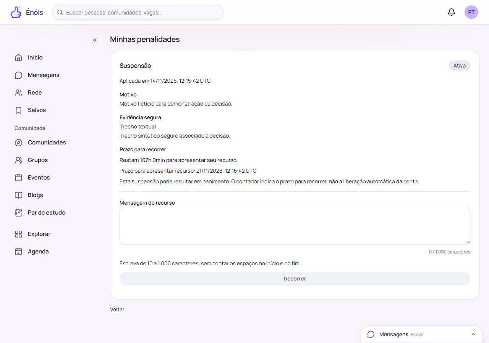
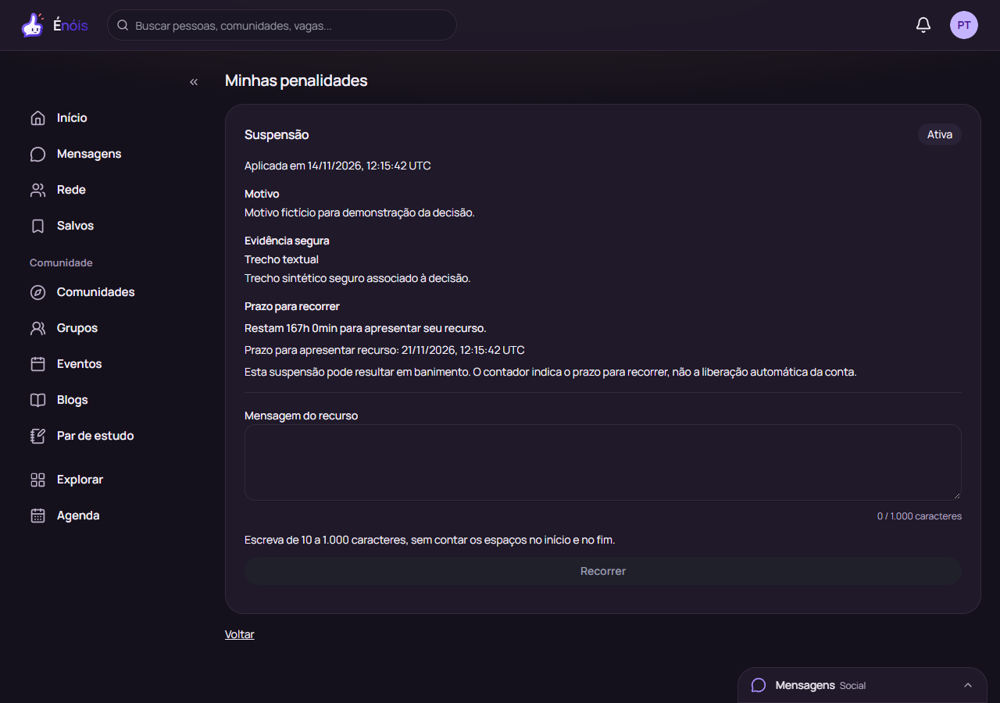
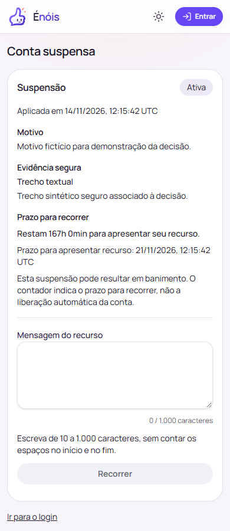
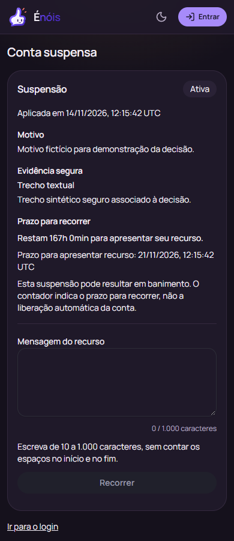
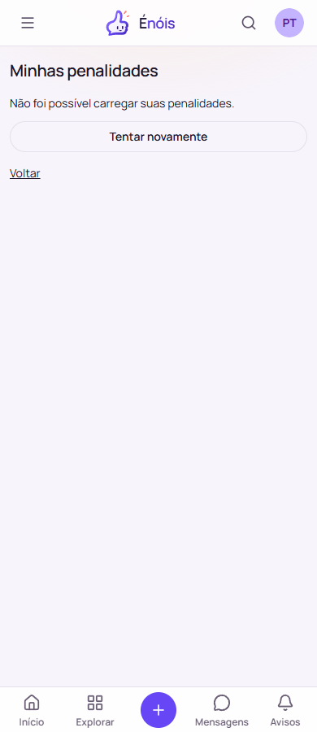
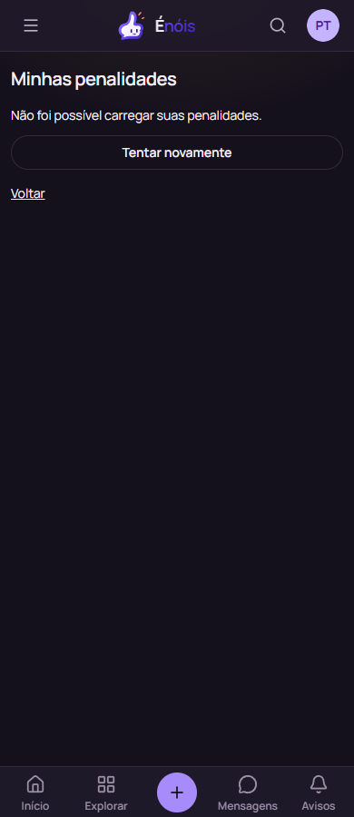

# Evidências visuais de penalidades e conta suspensa

> **Prova histórica anterior à reconciliação da QA.** As capturas e os totais deste documento
> permanecem vinculados à composição abaixo. Veja a [nova prova reconciliada](./reconciliacao-qa/README.md)
> para a composição atual; o resultado antigo não valida automaticamente os avanços da base.

Capturas de revisão das entregas frontend #875/#873 e design system #231, vinculadas às PRs
Rede-ENois/enois-frontend#883 e Rede-ENois/enois-design-system#236.

## Origem e limites

- Frontend real no commit `bb1322cd4eb129b28aac8905981e335c95a3d10c`, com DS empacotado a partir
  de `a524861f86587660e679217ed2a578d54fbe3ef4`.
- API explicitamente simulada e identidade/conteúdo fictícios. Não são capturas de produção nem
  prova de integração com backend real.
- O pacote local conserva a versão-base 0.34.1, mas contém as views ainda não publicadas. Essas
  capturas não comprovam instalação limpa pelo lockfile ou disponibilidade da versão necessária.
- Viewports: desktop de 1280 × 900 e mobile de 390 × 900, claro/escuro. São capturas da janela,
  não imagens de página inteira, para não distorcer a posição de elementos fixos.
- Seis capturas selecionadas da execução automatizada com 18 registros de verificação. O ensaio
  também cobriu vazio e recuperação do erro pelo teclado com uma consulta adicional, sem
  overflow horizontal ou erros inesperados.
- O texto do prazo vem da referência temporal da fixture; não representa uma punição real nem
  deve ser interpretado usando o relógio de quem visualiza a captura.

O botão de atualização manual está ausente no sucesso. A consulta ocorre ao entrar na página;
**Tentar novamente** permanece somente após erro. As imagens foram inspecionadas antes da
publicação, sem credenciais, conteúdo privado ou dados pessoais reais visíveis.

## Histórico: desktop

| Claro                                                                                         | Escuro                                                                                        |
| --------------------------------------------------------------------------------------------- | --------------------------------------------------------------------------------------------- |
|  |  |

## Conta suspensa: mobile

| Claro                                                                                                      | Escuro                                                                                                     |
| ---------------------------------------------------------------------------------------------------------- | ---------------------------------------------------------------------------------------------------------- |
|  |  |

## Falha de consulta: mobile

| Claro                                                                           | Escuro                                                                          |
| ------------------------------------------------------------------------------- | ------------------------------------------------------------------------------- |
|  |  |

## Verificações complementares

No mesmo código, foram aprovados lint, tipos, 1.438 testes do frontend e build com o pacote local;
o DS aprovou 1.884 testes, build e verificação de distribuição. Os testes das regras de ESLint e
os controles de crescimento do baseline também passaram nos dois repositórios.

Essas provas locais não substituem CI remoto autorizado, revisão humana, publicação coordenada
do DS ou a instalação limpa do consumidor. As PRs permanecem em rascunho.
