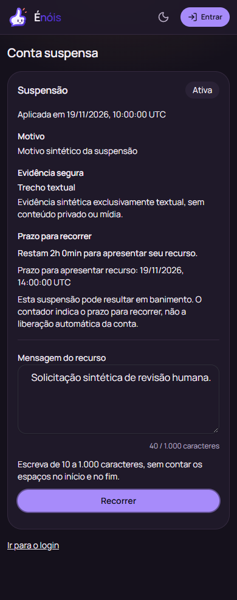
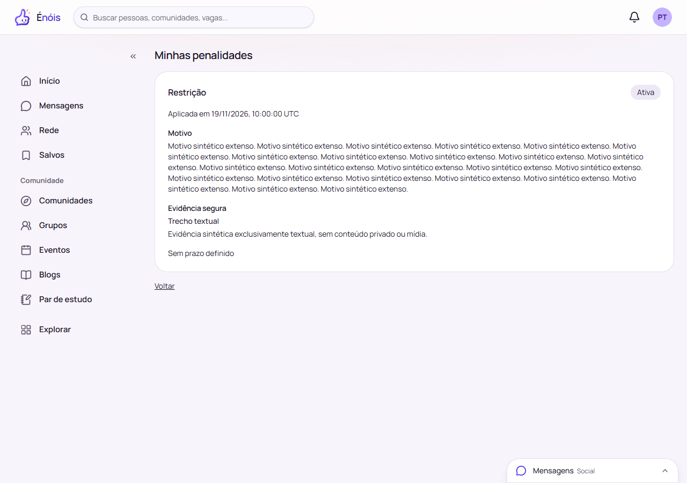
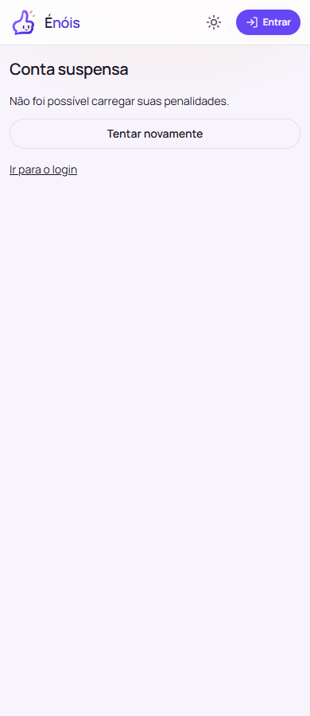
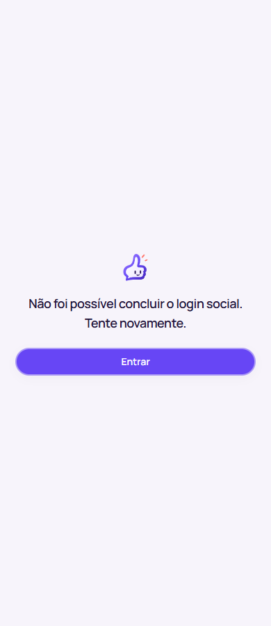

# Reconciliação de moderação: 19/11/2026

## Composição exercitada

- Código do frontend: `0b8c8c45fc56ae192fcd38314027a7466ab7fed3`.
- QA incorporada no frontend: `53762f7476a058f621f8f639c6f6721c0a406396`.
- Design system: `0ed24ef06b8216bb4d509cc1fd27f3ae14ef62a5`, com QA `7ffc77ff5ce71a9c3f23aab78f2d31a24142aed6`.
- Pacote local real: `@rede-enois/design-system@0.41.5`, versão herdada da QA, não uma release deste incremento.
- SHA-256 do tarball: `691ce47f0e2ef12acb1ef0c8e4084f1cf54df34d7aca01ebe42bef79cd43dbd6`.

O commit que acrescenta este documento e as imagens não muda código, dependências ou workflows. Os 1.992 arquivos da composição exercitada foram novamente conferidos após os gates e o navegador.

## Resultado local

| Verificação                                                | Resultado                                          |
| ---------------------------------------------------------- | -------------------------------------------------- |
| Lint, tipos e build de produção                            | Aprovados                                          |
| Regras locais de ESLint e baseline contra a QA incorporada | Aprovados                                          |
| Suíte completa do frontend                                 | 1.864 testes em 316 arquivos; zero falhas ou skips |
| Identidades contra a composição anterior desta rodada      | 14 adicionadas; nenhuma removida                   |
| Consumidor real no navegador                               | 40 cenários em 390/1280px, claro/escuro            |
| Contraste de texto ativo medido no consumidor              | 484 pares; mínimo 5,3946:1                         |
| Erros inesperados ou overflow nos cenários                 | Nenhum                                             |

A suíte do produtor também passou: 2.301 testes em 260 arquivos, build, entrypoints compilados, regras, baseline e Storybook. O integrador conferiu os fontes, os reporters, os logs e os 3.125 membros do pacote. Os 3.122 arquivos compilados permanecem iguais ao pacote local anterior; a versão mudou exclusivamente com a QA.

O Node 26 foi invocado explicitamente. `NODE_OPTIONS=--no-experimental-webstorage` foi usado somente nos processos de testes para não impedir o armazenamento fornecido pelo jsdom; não houve mudança de fonte, asserção ou configuração para acomodar o runtime.

## O que o navegador verificou

A aplicação e os componentes do DS são reais. Apenas a fronteira HTTP, as identidades e o segundo fator são sintéticos e isolados em loopback. Não foi usado login de uma pessoa nem backend de produção.

Os 32 cenários de apresentação cobrem carregamento, vazio, falha com recuperação, histórico com texto longo, suspensão elegível, pendência, remoção e decisão permanente. Conferem ausência de atualização manual no sucesso, elegibilidade, semântica do prazo e envio por teclado. Oito cenários adicionais exercitam os limites de sessão e o erro recuperável na conclusão do OAuth, com os containers e formulários reais.

As respostas HTTP 500 e 401 necessárias aos cenários de falha foram injetadas deliberadamente. Foram separadas dos erros inesperados, não silenciadas globalmente. A navegação nativa por Tab alcança a ação de recuperação do OAuth. O destino dessa ação também tem regressão pela interface pública da rota.

As quatro imagens abaixo foram inspecionadas. Usam dados fictícios; não são capturas de uma conta ou sanção real.

### Conta limitada: formulário e prazo de recurso

### Histórico com texto longo

### Falha de consulta com recuperação

### Falha recuperável na conclusão do OAuth

## Dependência de publicação permanece aberta

O manifesto e o lockfile da entrega não receberam caminho local ou versão futura. A instalação de prova foi feita em uma pasta isolada com um lock temporário derivado do original, alterando apenas `version`, `resolved` e `integrity` do DS para o tarball local real, compatível com a faixa declarada. As 485 versões instaladas foram conferidas contra essa resolução temporária; não houve ausência não opcional ou divergência. Isso **não** comprova instalação da futura release pelo registro privado.

A ordem continua: revisão humana e merge do DS, publicação RC/final autorizada, atualização coordenada da dependência e do lockfile do frontend, instalação limpa e nova validação. Esta prova local não permite merge automático, publicação de pacote, tag ou deploy.

As provas dos diretórios anteriores são históricas e permanecem vinculadas aos SHAs nelas declarados. Não validam automaticamente esta composição. Os servidores e navegadores desta prova foram encerrados.
