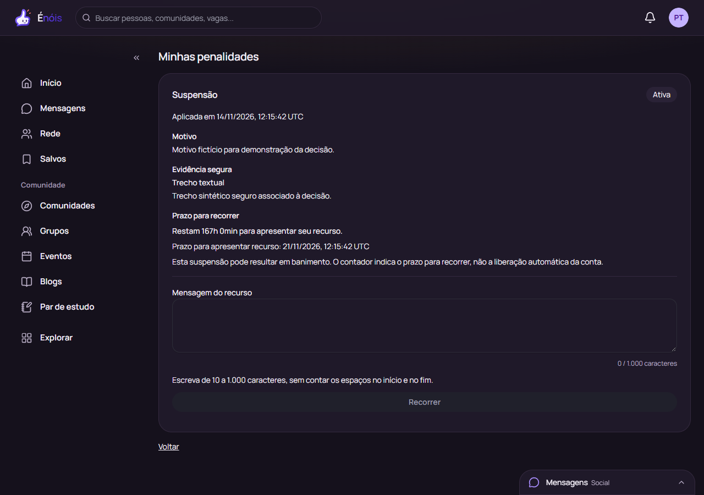
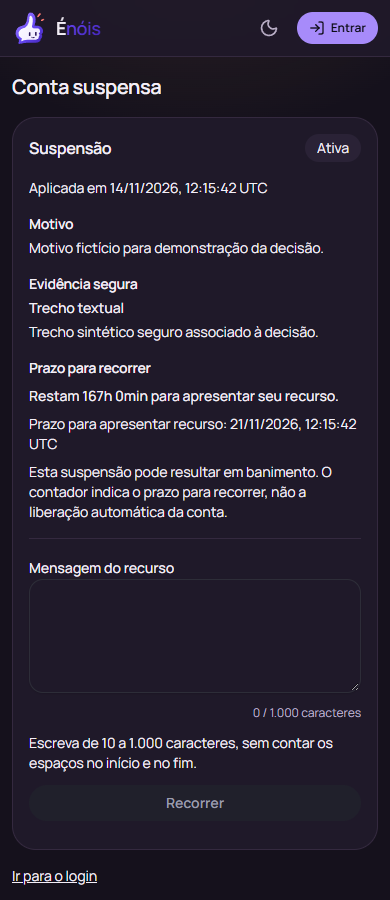
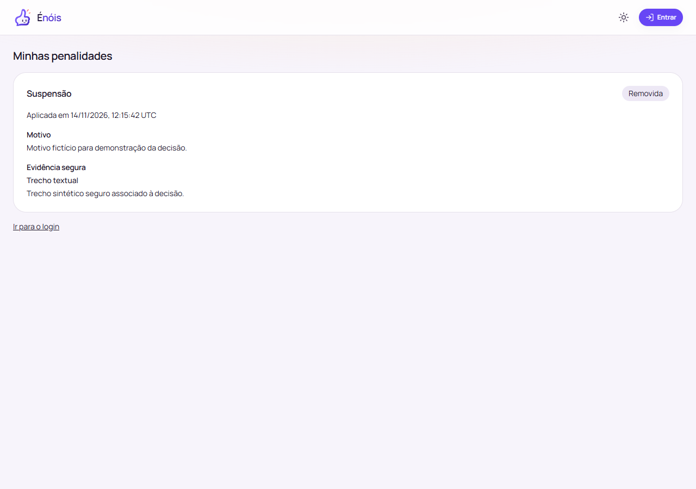

# Reconciliação das penalidades com a QA

> **Primeira composição reconciliada, preservada como histórica.** O novo avanço de QA e suas
> provas estão em [qa-b57.md](./qa-b57.md). Os totais abaixo continuam vinculados ao código aqui indicado.

## Composição exercitada

- Frontend: `e2b271f07acb9ae632d564514322cc2090fa173b`, incorporando a QA
  `874f3a101b78cd95e1df58d5fad026fceca5cc3d` por merges que preservam o head já publicado.
- DS local: `aeb03aec9e50e19e2ef4ffb98645d475d6f43440`, com QA
  `2ab39ec66706ddefecc09f04661e3151708007a1` e ContinueWriting preservado.
- SHA-256 do tarball local: `966404dd1b96c5545c3f630299193490e38eb61a6d8bd249cb9d54faa460c4ce`.
  Os 2.900 arquivos de `dist` instalados foram comparados ao tarball.
- Backend coordenado: `f796aba1f5b0865f2c54731cbe46859f379de1d6`, QA
  `ea07b0810f1dfe13d39d3fccbdf9fb095bea0bdb`. As capturas abaixo **não** usam esse backend:
  usam a aplicação real com API simulada e dados inequivocamente fictícios.

## Resoluções e provas

- Preservados `SanctionsContainer` no histórico, acesso à conta suspensa, rotas da QA e contrato
  explícito de motivo, evidência segura e prazo. `dueAt` opcional/nullable permanece compatível;
  a apresentação usa `deadline.kind/at`, sem prometer liberação ao fim do prazo.
- O sucesso não tem botão de atualização manual; cada entrada refaz a consulta. Erros mantêm
  **Tentar novamente**. A regressão de motivo/prazo aguarda conteúdo real e conserva a folga
  de execução da QA, sem esperar a remoção de uma região de status que continua montada.
- A atualização das dependências exigiu tipar explicitamente dois callbacks de busca com o
  tipo já fornecido pela rota. Nenhuma supressão ou configuração de qualidade foi relaxada.
- Lint, tipos, **1.607 testes em 278 arquivos**, build, testes das regras de ESLint e comparação
  do baseline com a QA incorporada passaram. Os 1.575 arquivos de código/configuração do
  inventário exercitado foram conferidos no commit. O arquivo de rotas foi regenerado pelo
  pipeline do aplicativo; lint, tipos e testes focados foram repetidos depois da geração.
- Navegador: **26 verificações**, em 390 × 900 e 1280 × 900, claro/escuro, incluindo histórico,
  conta suspensa, remoção, vazio, entrada com cache recente, erro e recuperação por teclado.
  Não houve overflow horizontal ou erro inesperado nas verificações. As quatro capturas
  selecionadas foram inspecionadas visualmente e não contêm credenciais ou dados pessoais reais.
- O relógio foi fixado para a fixture. Datas e contadores não descrevem uma penalidade real.

## Capturas da nova composição

## Limitações e próximos passos

As dependências foram preparadas fisicamente em worktree isolado, e o DS foi instalado por
**tarball local não publicado**, conservando a versão-base 0.37.5. Isso não comprova `npm ci`,
instalação limpa pelo lockfile ou disponibilidade publicada dessas views. Nenhum caminho local
foi salvo nos manifestos. A PR continua em rascunho até publicação RC/final autorizada do DS,
atualização coordenada da dependência/lockfile, instalação limpa e repetição dos gates.

As provas backend dessa composição registram 3.634 casos, zero falhas/erros e um skip da
integração externa opt-in. As provas DS registram 2.122 testes aprovados. São execuções
separadas, não um novo E2E completo entre os três projetos. CI remoto autorizado, revisão
humana, merge, publicação de pacote e deploy continuam sob controle dos mantenedores.
