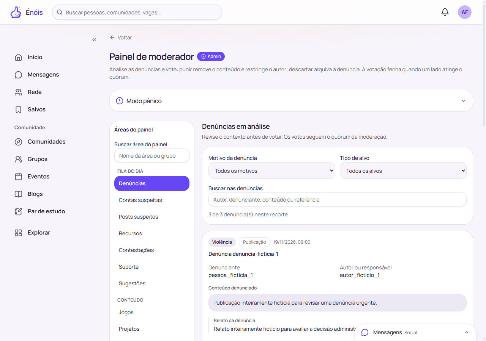
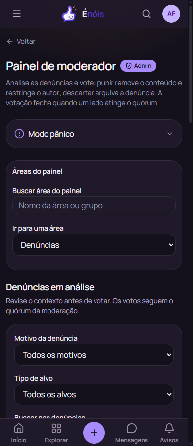
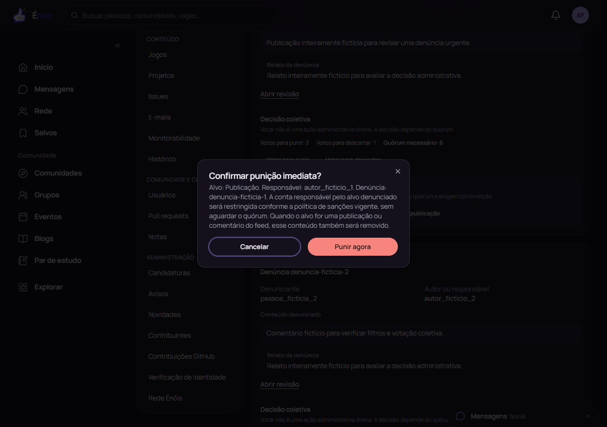
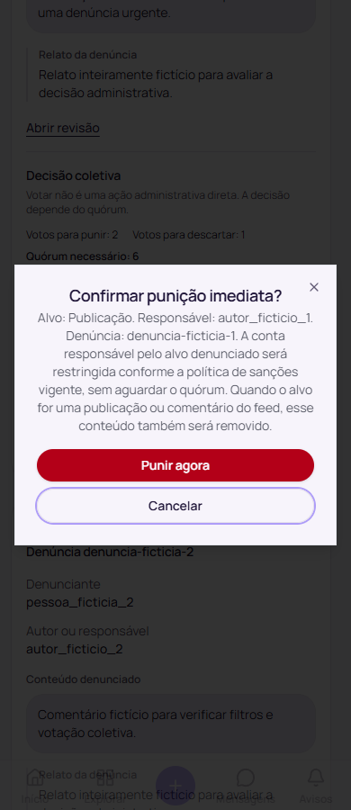

# Continuação de 19/11/2026: reconciliação da PR #893

**Estado: rascunho, não-pronto para merge.** A preparação reconcilia a branch publicada por merge,
preserva o histórico e mantém a dependência de um pacote do DS autorizado pela mantenedora. Não há
merge de PR, publicação de pacote, tag ou deploy nesta entrega. As provas de 14/11 são históricas.

## Composição preparada

- Head anterior da PR preservado: `87aa18e6973a319b7f30836e5bbdd33352e65611`.
- QA canônica incorporada: `98435bc02f42e384c7e9a917e7ca70629a876716`, consultada no remoto
  `upstream` de `Rede-ENois/enois-frontend`. Ela inclui a atualização de canal posterior ao pin
  `ab33189bfcb9badd708f43b6b575352454c3ff1a` recebido no início da tarefa.
- Base comum: `ef1e0d2ff518c0efac3bdaedee3aba1dab0795a0`.
- Backup local: `backup/frontend-893-antes-merge-19nov-87aa18e6`.
- Integração por `git merge --no-ff --no-commit` do pin acima, sem rebase ou reescrita de histórico.
  Testes e revisão estão vinculados aos inventários congelados, não somente ao HEAD.

A simulação e a merge não tiveram conflitos textuais. As duas sobreposições foram
`eslint-suppressions.json` e `src/texts.ts`, inspecionadas por conteúdo. As ações administrativas
diretas, seus tipos, as telas administrativas e o `PostType` da QA foram preservados. Nenhuma nova
view foi criada no frontend; `ModeratorWorkspace` e `ReportsSection` continuam sendo contratos do DS.

## Causa do lint vermelho e correção

O comparador do baseline foi reproduzido com a branch original contra o pin da QA. Resultado:
código 1, nove aumentos em pares arquivo/regra. A branch antiga conservava dívida já reduzida na
QA, inclusive editor de blog, seletor de figurinhas, enquetes, menções, marketplace e candidaturas.
Não eram nove violações introduzidas pelo painel.

A merge preserva todas essas reduções da QA e mantém a redução própria de markup em
`src/routes/moderador.tsx`, de 323 para 249. Não foi restabelecida nenhuma dívida removida.
O lint completo também identificou uma supressão sem uso na alteração mais recente do canal:
`src/routes/comunidades.$communityId.canais.$channelId.tsx`, de 47 para 46. A poda pelo próprio ESLint
removeu somente essa sobra. Todos os demais pares arquivo/regra permanecem iguais à QA.

O checkout Windows tinha CRLF em arquivos incorporados pela merge. A recuperação converteu 420
arquivos para LF somente quando o resultado era byte a byte igual ao blob do índice. O hash da
árvore staged permaneceu idêntico antes e depois. Nenhuma configuração global foi alterada e nenhum
formatter foi aplicado ao repositório inteiro. As tentativas iniciais foram preservadas nos logs;
não são apresentadas como falhas funcionais do painel.

## Checks independentes executados

| Check                                                                                          | Resultado                                             |
| ---------------------------------------------------------------------------------------------- | ----------------------------------------------------- |
| Comparador `node scripts/check-lint-suppressions.mjs 98435bc02f42e384c7e9a917e7ca70629a876716` | Código 0; nenhuma entrada aumentou                    |
| ESLint completo                                                                                | Código 0; zero erros e 16 avisos, sem desligar regras |
| Três scripts de teste das regras locais de ESLint                                              | Todos com código 0                                    |
| Cinco arquivos de testes independentes do pacote DS                                            | 27 testes aprovados; zero falhas ou pendências        |
| `git diff --check HEAD`                                                                        | Código 0                                              |

Os testes cobrem grupos de navegação, tipos de publicação, mapeamento de membros administrativos,
cliente de entidades administrativas e métricas de moderação. Isso não substitui os testes de
container com as views reais nem a suíte completa. O aviso existente de configuração esbuild/oxc foi
mantido. Os 16 avisos de lint não foram suprimidos.

## Consumidor real e verificação visual

`package.json` e `package-lock.json` são os da QA incorporada: DS `^0.41.4`, travado em `0.41.4`.
Não há caminho `file:` acrescentado nem versão futura inventada. Foi instalado exclusivamente neste
worktree o tarball local da feature, sem salvar dependência ou alterar o lockfile. Os **3137 membros**
do artefato foram comparados byte a byte com o pacote instalado e oito exports compilados foram
importados, incluindo fila, workspace e as views administrativas atuais da QA.

- Tarball local `0.41.4`, SHA-256 `3b4fc2794ee30942d69b1666c5ff6f8fbf51f2bdf9eb78f9eeb46c54d583962b`.
- Lint e typecheck completos aprovados, além dos checks independentes acima.
- **1810 testes em 307 arquivos**, zero falhas, skips ou todo na execução integral final.
- Build de produção Nitro `node-server` aprovado. A prova utiliza `/api` relativo e proxy de mesma
  origem exclusivamente local para a fixture; a CSP do aplicativo não foi relaxada.
- **44 verificações no aplicativo compilado**, em 1280 × 900 e 390 × 900, claro e escuro. O Storybook
  compilado do DS recebeu outras 52 verificações, registradas separadamente, não como E2E do app.
- Abertura/cancelamento da confirmação sem chamada de decisão; envio e reconsulta da fila;
  restauração de foco por teclado; moderador sem ações administrativas, mas com voto coletivo;
  busca, filtros, erro/recuperação, erro de A não herdado por B e pânico incerto bloqueado.
- Sem overflow horizontal nem erros JavaScript inesperados nos estados inspecionados. Falhas HTTP
  503 de consulta/ação foram deliberadamente simuladas para verificar o erro, não falhas de produção.
- Contraste computado no app: 232 amostras, mínimo **5.3946:1**; Storybook: 160 amostras, mínimo
  **6.0002:1**. Medição dos textos/controles inspecionados, não auditoria de todo o produto.

As tentativas preparatórias de instrumentação foram preservadas. Uma primeira execução unitária
recebeu indevidamente a URL absoluta da fixture e falhou em cinco expectativas de URL relativa;
a execução final usou o ambiente canônico de testes, sem alteração de código ou asserções. A aba de
prova exigiu foco emulado para concluir animações de saída. Um seletor do harness foi corrigido para
o rótulo real do botão. Nenhuma dessas correções alterou código produtivo.

### Auditoria HTTP da rodada final

A auditoria encontrou respostas 404 na primeira fixture para consultas auxiliares do shell: perfil,
idade e comunidades. Ao completar esses contratos, a hidratação do perfil revelou também a consulta
do perfil profissional. As rodadas incompletas foram preservadas como provas limitadas, não como
validação HTTP limpa de toda a tela.

A fixture final passou a responder os cinco contratos conforme os DTOs reais, sem alterar o produto.
**As mesmas 44 verificações do aplicativo foram repetidas e aprovadas**, em todos os tamanhos/temas
anteriores. O registro HTTP da rodada final não contém 4xx nem falha não prevista; há somente os
503 deliberados nos cenários de fila, ação administrativa e pânico. As capturas abaixo pertencem a
essa rodada completa. Os reruns não são somados como casos novos. Código, dependências e build
permanecem os já exercitados; este complemento altera somente documentação e imagens.

### Capturas do aplicativo compilado

Todas as pessoas, alvos e decisões são fictícios. São capturas reais do frontend com **API simulada**,
não produção, integração com backend real ou prova de autorização no servidor. As imagens de viewport
não mostram de uma vez o conteúdo vertical que exige rolagem.

## Bloqueio de liberação e trabalho restante

O número `0.41.4` do tarball foi herdado da QA; **não comprova release publicada contendo a feature**.
A instalação reutilizou dependências físicas e o cache local. Não é instalação limpa pelo lockfile
nem acesso autenticado ao registro. A consulta ao GitHub Packages retornou E401, sem token fornecido;
não foram procuradas credenciais em arquivos ou em outro cliente.

A PR permanece em rascunho. A mantenedora precisa aprovar o DS e publicar RC/final conforme o fluxo
do projeto. Depois disso, ainda cabe ao autor atualizar dependência/lockfile no escopo mínimo,
executar instalação limpa da composição publicada e repetir gates e CI. O verde com tarball local
não encerra essa dependência, nem autoriza merge ou deploy.

## Artefatos de continuidade

Os artefatos locais incluem reporters JSON, logs, RED/GREEN do comparador, inventários e hashes da
composição, identidade do pacote instalado, build e verificações de navegador. Os resumos públicos
não copiam logs brutos, credenciais ou dados pessoais. A fonte produtiva exercitada corresponde ao
snapshot de revisão congelado; documentação e capturas posteriores são identificadas separadamente.
